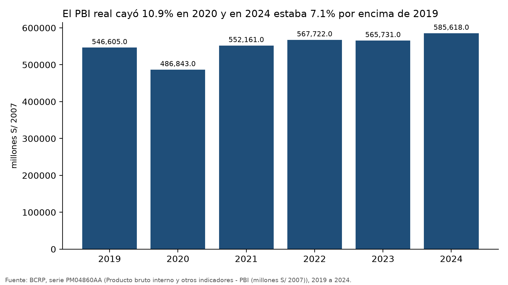
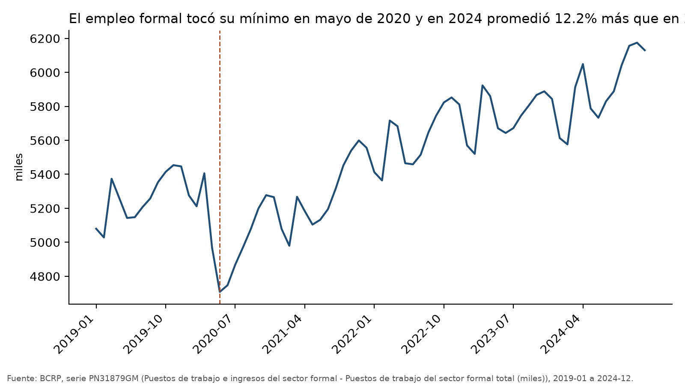
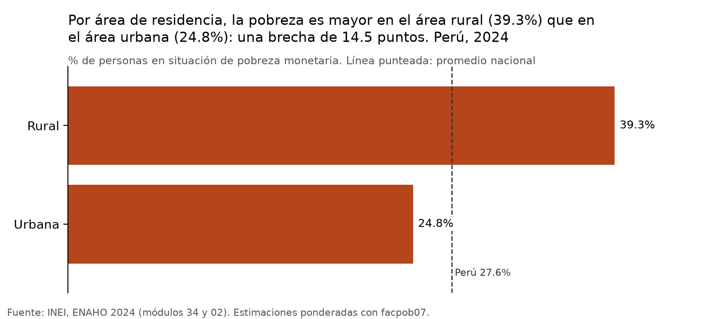
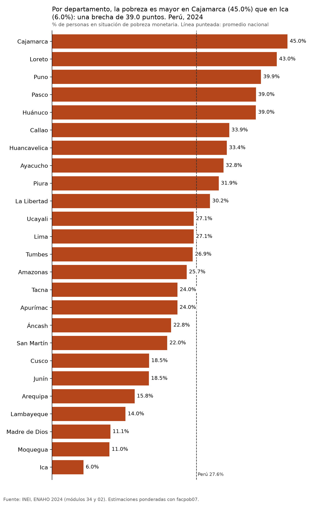
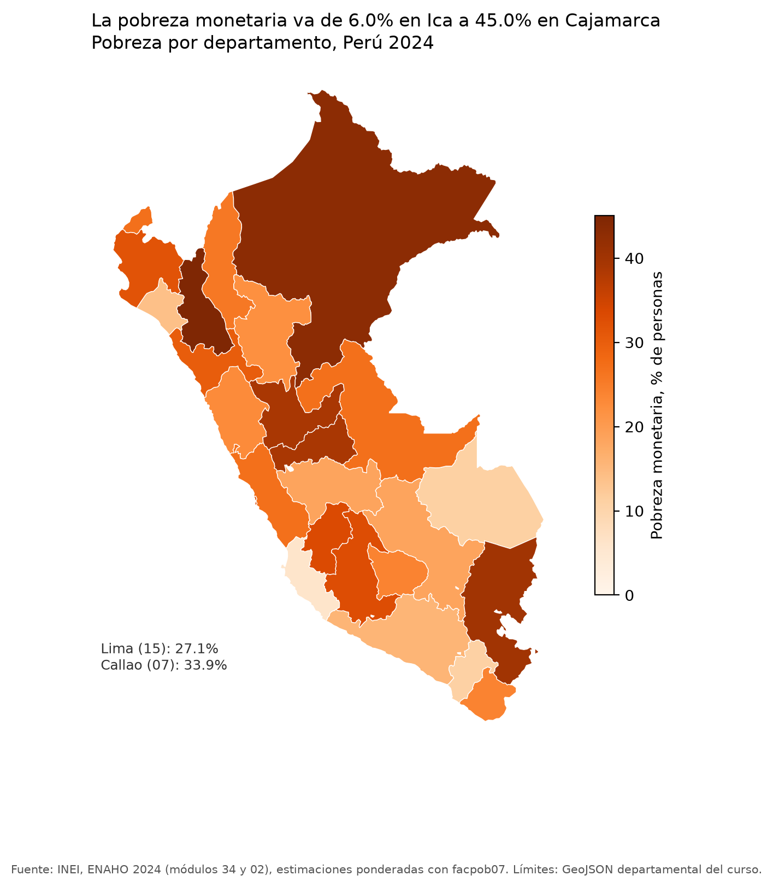

# Recuperación económica tras 2020 y desigualdad de la pobreza en el Perú, 2024

## 1. Pregunta de investigación

**Tema.** La evolución de la actividad económica y del empleo formal después del choque de 2020, y cómo se distribuía la pobreza monetaria en 2024.

**Pregunta.** ¿Cuánto se recuperaron la producción y el empleo del Perú después de la caída de 2020, y qué tan desigual era la pobreza entre zonas urbanas y rurales y entre departamentos en 2024?

**Objetivo.** Medir la caída y la recuperación del PBI real y de los puestos de trabajo formales entre 2019 y 2024, y describir las brechas de pobreza monetaria por área de residencia y por departamento en 2024.

**Delimitación.**
- Producción y empleo: series nacionales del BCRP, de 2019 a 2024.
- Pobreza: corte transversal de la ENAHO 2024, con 25 departamentos (Lima y Callao por separado) y dos áreas, urbana y rural.
- El informe describe asociaciones y no estima efectos causales.

## 2. Fuentes y metodología

**Datos.**

| Fuente | Serie o archivo | Uso |
|---|---|---|
| BCRP | `PM04860AA`: PBI (millones de S/ de 2007), anual | Producción real |
| BCRP | `PN31879GM`: puestos de trabajo del sector formal total (miles), mensual | Empleo formal |
| INEI, ENAHO 2024 | Módulo 34 (sumaria, `datos/966-Modulo34.zip`) y módulo 02 (miembros del hogar, `datos/966-Modulo02.zip`) | Pobreza monetaria |
| Límites | `datos/peru_departamental_simple.geojson` | Mapa departamental |

**Procesamiento.**
- **BCRP.** Las series se buscaron y consultaron con las herramientas del servidor MCP `bcrp` (`buscar_series`, `serie`, `resumen`, `comparar_periodos` y `graficar_serie`). Ninguna variación se calculó a mano: todas salen de `resumen` o de `comparar_periodos`.
- **Limpieza de la ENAHO.** La skill `limpiando-enaho` unió la sumaria con el módulo de miembros (unión m:1 por `conglome`, `vivienda` y `hogar`). La base de personas quedó en `salidas/personas_2024.parquet` y los indicadores en `salidas/indicadores.csv`.
- **Gráficos y mapa.** La skill `graficando-enaho` generó los gráficos por área y por departamento. La skill `mapeando-enaho` hizo la coropleta, uniendo por código de departamento (`ubigeo[:2]` con `FIRST_IDDP`).

**Indicadores.**
- Variación del PBI real: 2019 frente a 2020, 2021 y 2024.
- Empleo formal: promedio mensual de 2019 frente al de 2020 y al de 2024, y mínimo mensual del periodo.
- Tasa de pobreza monetaria: porcentaje de personas pobres, ponderado con el factor de expansión `facpob07`. Se calcula a nivel nacional, por área y por departamento.
- Brecha de pobreza rural–urbana y rango entre departamentos, en puntos porcentuales. Ambos los informa el script de gráficos.

**Contraste.**
- `salidas/validacion.txt` registra 19 verificaciones, todas en [OK]. Entre ellas: pobreza nacional de 27.58% frente a 27.6% del INEI, urbana de 24.81% frente a 24.8%, rural de 39.30% frente a 39.3%, y 25 códigos departamentales.
- `salidas/mapa_vs_referencia_2024.csv` compara los 25 departamentos con la referencia. La diferencia máxima es de 0.05 puntos.
- `informes/verificar_cifras.py` recalcula las cifras por un camino independiente: consulta directamente la API del BCRP y usa los `.dta` originales. Reprodujo los mismos valores del PBI y del empleo formal, la pobreza nacional (27.58%), la urbana (24.81%), la rural (39.30%) y los extremos departamentales: Ica (código 11), 6.01%, y Cajamarca (código 06), 45.01%.

## 3. Resultados

**Hallazgo 1. El PBI real cayó 10.9% en 2020, recuperó su nivel previo en 2021 y en 2024 era 7.1% mayor que en 2019.**
- 2019: S/ 546,605 millones de 2007. 2020: S/ 486,843 millones, una variación de −10.93% (`resumen`, `PM04860AA`, 2019–2020).
- 2021: S/ 552,161 millones, 1.02% por encima de 2019 (`resumen`, `PM04860AA`, 2019–2021).
- 2024: S/ 585,618 millones, 7.14% más que en 2019 (`comparar_periodos`, `PM04860AA`, 2019 frente a 2024). Ese año marca el máximo del periodo. En 2023 el nivel bajó ligeramente frente a 2022 (S/ 565,731 frente a S/ 567,722 millones).
- Fuente: <https://estadisticas.bcrp.gob.pe/estadisticas/series/api/PM04860AA/json/2019/2024>

**Hallazgo 2. El empleo formal tocó fondo en mayo de 2020 y en 2024 superaba con holgura su nivel de 2019.**
- El mínimo mensual del periodo 2019–2024 fue de 4,708.0 miles de puestos, en mayo de 2020 (`resumen`, `PN31879GM`, 2019-01 a 2024-12).
- El promedio de 2020 (5,081.1 miles) fue 3.47% menor que el de 2019 (5,263.8 miles) (`comparar_periodos`, `PN31879GM`, 2019 frente a 2020).
- El promedio de 2024 (5,907.8 miles) fue 12.23% mayor que el de 2019 (`comparar_periodos`, `PN31879GM`, 2019 frente a 2024).
- El máximo del periodo fue de 6,174.7 miles, en noviembre de 2024.
- Fuente: <https://estadisticas.bcrp.gob.pe/estadisticas/series/api/PN31879GM/json/2019-1/2024-12>

**Hallazgo 3. En 2024 la pobreza rural superaba a la urbana por 14.5 puntos.**
- Pobreza nacional: 27.58%. Urbana: 24.81%. Rural: 39.30% (`salidas/indicadores.csv` y `salidas/validacion.txt`).
- La brecha de 14.5 puntos la informa el script de `graficando-enaho` en el título de `figuras/pobreza_por_area_2024.png`.
- Aunque la tasa urbana es menor, el área urbana concentra la mayor parte de la población expandida: 27.9 millones de personas frente a 6.6 millones en el área rural (`salidas/indicadores.csv`, columna `poblacion_expandida`).

**Hallazgo 4. Entre departamentos, la pobreza iba de 6.0% en Ica a 45.0% en Cajamarca, un rango de 39.0 puntos.**
- Los cinco departamentos con más pobreza fueron Cajamarca (45.01%), Loreto (42.97%), Puno (39.94%), Pasco (38.97%) y Huánuco (38.96%).
- Los cinco con menos fueron Ica (6.01%), Moquegua (10.97%), Madre de Dios (11.15%), Lambayeque (14.04%) y Arequipa (15.78%). Fuente: `salidas/indicadores.csv` y `salidas/mapa_vs_referencia_2024.csv`.
- Diez departamentos superaban el promedio nacional de 27.6%: Cajamarca, Loreto, Puno, Pasco, Huánuco, Callao, Huancavelica, Ayacucho, Piura y La Libertad. Fuente: `figuras/pobreza_por_departamento_2024.png`.
- Callao (33.86%) registraba más pobreza que Lima (27.07%).

## 4. Visualizaciones

**PBI real, 2019–2024 (BCRP, `PM04860AA`).**



**Puestos de trabajo formales, enero de 2019 a diciembre de 2024 (BCRP, `PN31879GM`).**



**Pobreza monetaria por área de residencia, 2024 (ENAHO).**



**Pobreza monetaria por departamento, 2024 (ENAHO).**



**Mapa de la pobreza monetaria por departamento, 2024 (ENAHO).**



## 5. Interpretación

- **Recuperación agregada completa.** Tanto la producción como el empleo formal superaron en 2024 sus niveles de 2019. El empleo formal promedio creció más (12.2%) que el PBI real (7.1%) frente a 2019. Las dos series miden cosas distintas (volumen de producción y número de puestos formales), así que esa diferencia no debe leerse como un aumento de productividad ni como su contrario.
- **El nivel nacional no muestra la distribución.** Con la economía por encima de su nivel previo, 27.6% de la población seguía en pobreza monetaria en 2024. Como la ENAHO usada es solo de 2024, este informe no permite decir si la pobreza volvió a su nivel de antes de 2020.
- **Dos brechas que se superponen.** La pobreza es más alta en el área rural y en un grupo de departamentos de la sierra y la selva norte y central: Cajamarca, Loreto, Puno, Pasco y Huánuco. Los niveles más bajos están en departamentos de la costa sur (Ica, Moquegua, Arequipa) y en Madre de Dios. Callao y Lima, mayoritariamente urbanos, tienen tasas cercanas o superiores al promedio nacional, lo que muestra que la pobreza no es solo un fenómeno rural.
- **Ningún vínculo causal.** Los datos del BCRP son agregados nacionales y la ENAHO es un corte de un solo año. Ninguna cifra de este informe permite atribuir las diferencias de pobreza a la recuperación ni a su ausencia: solo describen patrones que coexisten.

## 6. Limitaciones

- **Cobertura temporal.** Las series del BCRP cubren 2019–2024, pero la pobreza solo se mide en 2024. No hay comparación de la pobreza antes y después de 2020.
- **Nivel de agregación.** El PBI y el empleo formal son nacionales. No se usaron series regionales del BCRP, así que no se puede relacionar la recuperación de cada departamento con su pobreza.
- **Empleo formal no es empleo total.** `PN31879GM` cuenta puestos de trabajo formales (planilla), no personas ocupadas. Deja fuera el empleo informal, que es la mayor parte del empleo en el Perú. Un puesto no equivale a una persona.
- **Calidad de los datos de la ENAHO.** Es una encuesta por muestreo y las cifras son estimaciones puntuales sin intervalos de confianza. Diferencias pequeñas entre departamentos pueden no ser significativas: por ejemplo, Pasco (38.97%) y Huánuco (38.96%), Lima y Ucayali (27.07% ambos), o Cusco (18.54%) y Junín (18.50%). Algunos departamentos tienen muestras chicas, como Madre de Dios con 2,049 personas y Moquegua con 2,535 (`salidas/indicadores.csv`).
- **Medida de pobreza.** Solo se usa la pobreza monetaria (gasto frente a la línea de pobreza). No se analizan la pobreza multidimensional ni la desigualdad de ingresos.
- **PBI anual.** La serie anual no muestra la trayectoria trimestral de la caída y del rebote dentro de 2020 y 2021.
- **Gráfico del PBI.** Por ser una serie anual se grafica en barras, sin línea de marca; 2020 es la barra más baja.
- **Herramientas.** Todas las herramientas del MCP y las skills terminaron sin errores.

## 7. Reproducibilidad

**BCRP (servidor MCP `mcp/`).**

| Herramienta | Llamada |
|---|---|
| `buscar_series` | `"producto bruto interno 2007"` (Anual) y `"empleo formal"` |
| `serie` | `PM04860AA`, 2019–2024 |
| `resumen` | `PM04860AA`: 2019–2024, 2019–2020 y 2019–2021; `PN31879GM`: 2019-01 a 2024-12 |
| `comparar_periodos` | `PM04860AA`: 2019 frente a 2024; `PN31879GM`: 2019-01/2019-12 frente a 2024-01/2024-12 y frente a 2020-01/2020-12 |
| `graficar_serie` | `PM04860AA`, 2019–2024, marca 2020, resultado en `figuras/bcrp_PM04860AA_2019_2024.png`; `PN31879GM`, 2019-01 a 2024-12, marca 2020-05, resultado en `figuras/bcrp_PN31879GM_2019-01_2024-12.png` |

**ENAHO (skills en `.claude/skills/`).** Desde la carpeta `tarea_4/`:

```bash
uv run .claude/skills/limpiando-enaho/scripts/limpiar.py --anio 2024
uv run .claude/skills/graficando-enaho/scripts/graficar.py --anio 2024 --por area
uv run .claude/skills/graficando-enaho/scripts/graficar.py --anio 2024 --por departamento
uv run .claude/skills/mapeando-enaho/scripts/mapear.py --anio 2024
```

**Verificación independiente.**

```bash
uv run informes/verificar_cifras.py
```

**Archivos generados.**
- `salidas/personas_2024.parquet`
- `salidas/indicadores.csv`
- `salidas/validacion.txt`
- `salidas/mapa_vs_referencia_2024.csv`
- `figuras/bcrp_PM04860AA_2019_2024.png`
- `figuras/bcrp_PN31879GM_2019-01_2024-12.png`
- `figuras/pobreza_por_area_2024.png`
- `figuras/pobreza_por_departamento_2024.png`
- `mapas/pobreza_departamento.png`

## 8. Verificación manual de cifras

Cifras del informe comprobadas por un camino distinto al del agente: la API pública del BCRP consultada directamente (sin el servidor MCP) y la pobreza recalculada desde la sumaria original con `factor07 × mieperho` (sin las skills). Comando: `uv run informes/verificar_cifras.py`.

| Afirmación del informe | Valor del informe | Valor verificado | Fuente o procedimiento | ¿Coincide? |
|---|---:|---:|---|---|
| Caída del PBI real en 2020 | −10.93% | −10.93% (486,843 / 546,605 − 1) y −10.9333% en la serie oficial de variación `PM04863AA` | API BCRP, `PM04860AA` y `PM04863AA`, 2019–2024 | Sí |
| PBI real de 2024 frente a 2019 | +7.14% | +7.14% (585,618 / 546,605 − 1) | API BCRP, `PM04860AA` | Sí |
| Empleo formal promedio de 2024 frente a 2019 | +12.23% | +12.23% (5,907.8 / 5,263.8 miles − 1) | API BCRP, `PN31879GM`, promedio de los 12 meses de cada año | Sí |
| Mínimo del empleo formal | 4,708.0 miles, mayo de 2020 | 4,707.996 miles, May.2020 | API BCRP, `PN31879GM` | Sí |
| Pobreza nacional 2024 | 27.58% | 27.58%; INEI publica 27.6% | Sumaria 2024 con `factor07 × mieperho` | Sí, diferencia de redondeo de 0.02 puntos |
| Pobreza rural y urbana 2024 | 39.30% y 24.81% | 39.30% y 24.81%; referencia 39.3% y 24.8% | Sumaria 2024 por `estrato` (urbano si es 5 o menos) | Sí |
| Extremos departamentales | Ica 6.0%, Cajamarca 45.0% | Ica 6.01%, Cajamarca 45.01%; referencia de la sesión 6.0% y 45.0% | Sumaria 2024 por `ubigeo[:2]` y `.claude/skills/mapeando-enaho/scripts/referencia_pobreza_2024.csv` | Sí |
| Departamentos sobre el promedio nacional | 10 | 10 | `salidas/indicadores.csv`, conteo de `pobreza_pct` mayor a 27.58 | Sí |

No se observaron diferencias más allá del redondeo. Cuando una consulta no tiene datos, el agente lo informa en lugar de estimar: en `evidencias_ia/integracion/manejo_errores.jsonl`, ante una serie inexistente (`XX999`) y un año sin datos (1850), respondió que no podía dar la cifra y citó el error de la herramienta.
